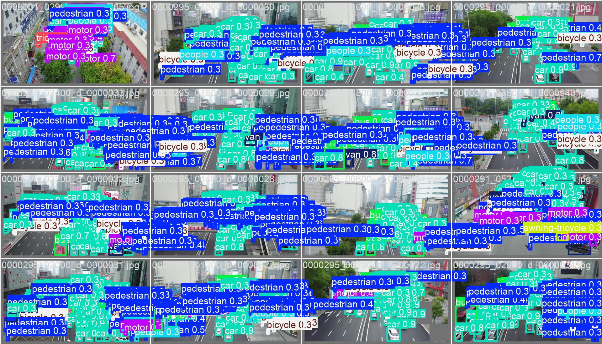
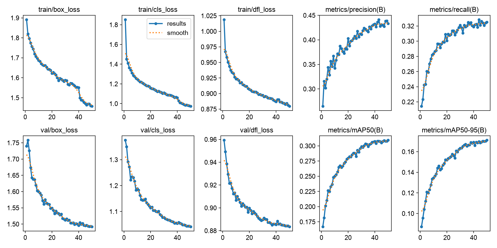
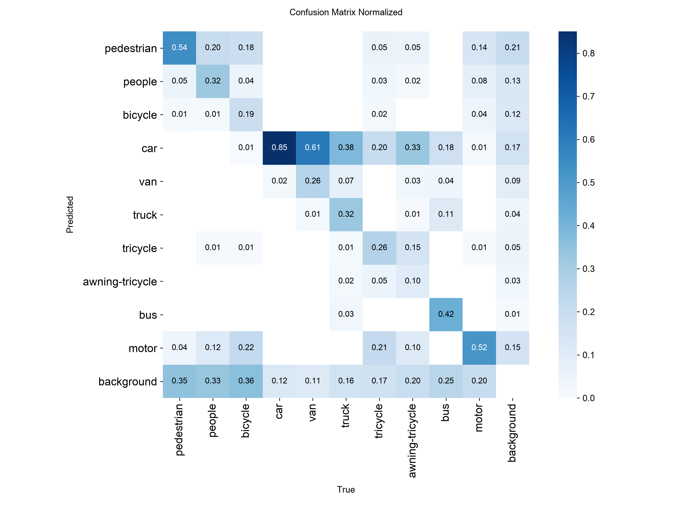

# SkyTrack: Aerial Object Detection from Drone Imagery

Detecting people and vehicles in drone footage, where most objects are only a few pixels wide.
Built on the [VisDrone2019-DET](https://github.com/VisDrone/VisDrone-Dataset) dataset with
[Ultralytics YOLO](https://docs.ultralytics.com/).

**Status: in progress.** Data exploration, preprocessing and a baseline detector are done.
Multi-object tracking is next.



## Why this is hard

VisDrone objects are very small. In the validation set:

- the median object is **23 px** (sqrt of box area), and **68%** are under 32 px (COCO's "small")
- after YOLO's resize to 640 px, the median drops to **11.4 px**, and **30%** are under 8 px
- pedestrians and people are the smallest (~8 px at 640); cars and vans are ~16 px
- classes are imbalanced: cars and pedestrians dominate, while buses and awning-tricycles are rare

## Preprocessing

`convert_split()` in [`src/skytrack/visdrone.py`](src/skytrack/visdrone.py) converts a raw VisDrone
split into YOLO format (`cls x_center y_center width height`, normalized 0–1):

| # | Rule | Why | Val | Train |
|---|------|-----|-----|-------|
| 1 | Keep only `score == 1` and categories 1–10 | Ignored regions and "others" aren't training targets | 1,410 removed | 10,345 removed |
| 2 | `cls = category - 1` | YOLO expects classes 0–9 | | |
| 3 | Clip boxes to the image edges | Coordinates must stay within 0–1 | 0 | 0 |
| 4 | Drop boxes under 2 px wide or tall | Too small to learn from | 0 | 8 |
| 5 | Paint ignored regions gray in train **and** val | Unlabeled people and vehicles would otherwise be learned as background, and correct detections there would count as false positives | 340 of 548 images | |

Result: 6,471 train images (343,197 boxes) and 548 val images (38,759 boxes).

## Baseline detector

YOLO11n (COCO-pretrained), fine-tuned for 50 epochs at 640 px, batch size 8, on an Apple M4 (MPS),
about 5.5 hours.

**Overall (val): mAP50 0.300, mAP50-95 0.168, precision 0.43, recall 0.33**

| Class | mAP50 | mAP50-95 | Instances |
|---|---|---|---|
| car | 0.725 | 0.475 | 14,064 |
| bus | 0.423 | 0.281 | 251 |
| van | 0.345 | 0.229 | 1,975 |
| motor | 0.328 | 0.127 | 4,886 |
| pedestrian | 0.323 | 0.130 | 8,844 |
| truck | 0.274 | 0.177 | 750 |
| people | 0.232 | 0.076 | 5,125 |
| tricycle | 0.193 | 0.104 | 1,045 |
| awning-tricycle | 0.087 | 0.053 | 532 |
| bicycle | 0.069 | 0.026 | 1,287 |

**Findings**

- Before training, I predicted the smallest classes (pedestrian, people, bicycle, motor) would do worst.
  People and bicycle did, but pedestrian and motor came out near average. Object size alone didn't
  predict performance; class frequency and visual similarity mattered too.
- 20% of "people" were predicted as "pedestrian", but only 5% of pedestrians as people. The model leans
  toward the more common class, and the two look nearly identical from above.
- Small objects lose much more under strict IoU: pedestrian falls from 0.323 (mAP50) to 0.130 (mAP50-95),
  while car falls from 0.725 to 0.475. A few pixels of error ruins the overlap on an 8 px box.
- No overfitting: validation loss kept falling through epoch 50, and mAP leveled off after about epoch 40.

| Training curves | Confusion matrix (normalized) |
|---|---|
|  |  |

## Reproduce

```bash
python -m venv .venv && source .venv/bin/activate
pip install -e .

# Download VisDrone2019-DET (train and val) into data/raw/
curl -L -o data/raw/train.zip https://github.com/ultralytics/assets/releases/download/v0.0.0/VisDrone2019-DET-train.zip
curl -L -o data/raw/val.zip https://github.com/ultralytics/assets/releases/download/v0.0.0/VisDrone2019-DET-val.zip
unzip -q data/raw/train.zip -d data/raw && unzip -q data/raw/val.zip -d data/raw
```

```python
from skytrack.visdrone import convert_split
convert_split("data/raw/VisDrone2019-DET-train", "data/yolo/train")
convert_split("data/raw/VisDrone2019-DET-val", "data/yolo/val")
```

Then set `path` in `visdrone.yaml` to your absolute `data/yolo` folder and train:

```bash
yolo detect train data=visdrone.yaml model=yolo11n.pt epochs=50 imgsz=640 batch=8 device=mps
```

## Project layout

```
src/skytrack/visdrone.py   loading, drawing and YOLO conversion
Notebooks/01_explore       dataset exploration and object-size analysis
Notebooks/02_processing    cleaning rules and conversion checks
Notebooks/03_baseline      baseline training and evaluation
visdrone.yaml              YOLO dataset config
docs/                      result plots used in this README
```

## Next steps

- Higher input resolution or image tiling to help the smallest objects
- Multi-object tracking on VisDrone2019-MOT (IoU matching, Kalman filter, camera-motion compensation)
- Tracking metrics (MOTA, IDF1) and robustness tests (blur, low light, noise)
